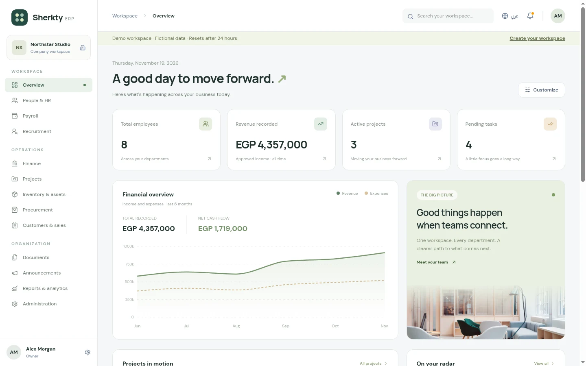
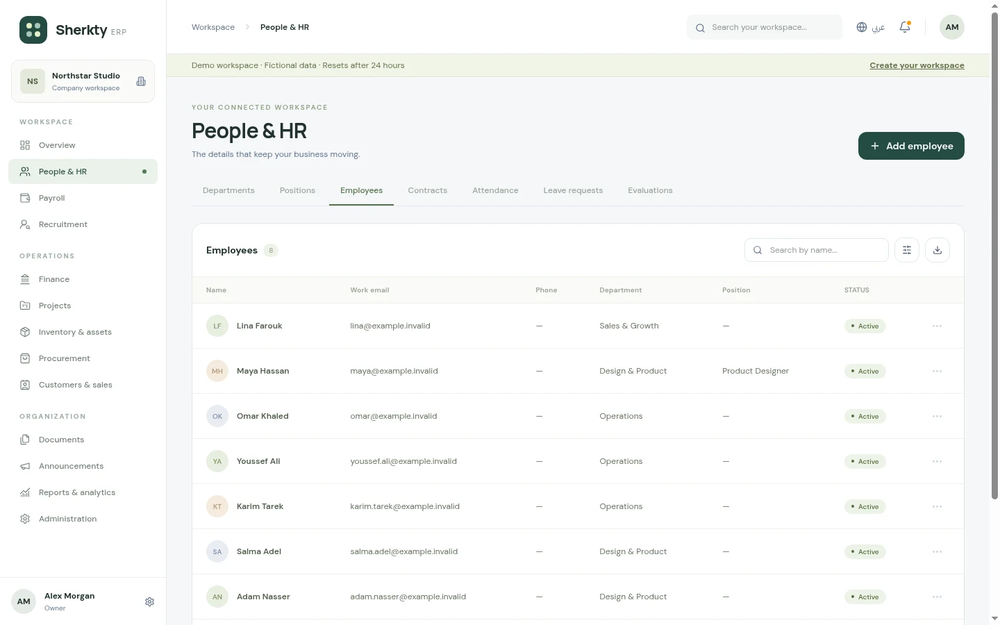
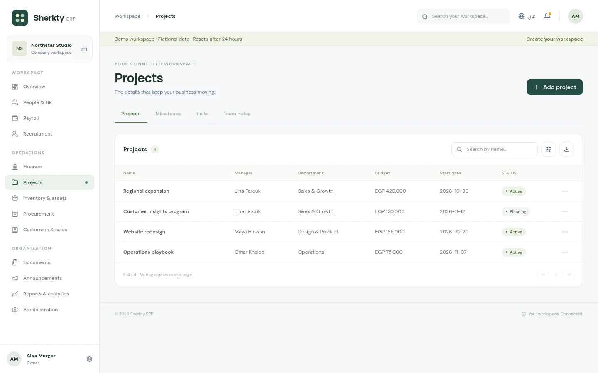
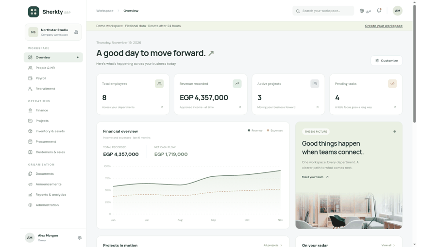
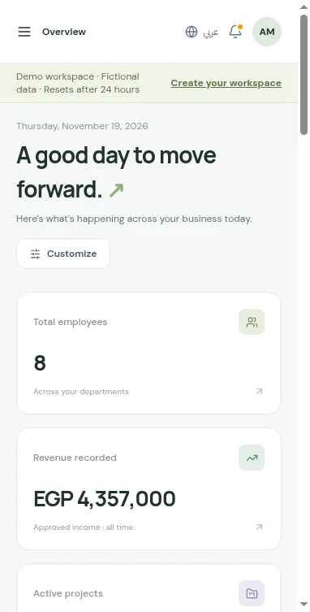

# Sherkty

[Open the live application](https://sherkty.pages.dev/)

## See it in action

Company overview, fictional employee directory and project tracking.



| People | Projects |
| --- | --- |
|  |  |

### Short interface tour



A short GIF of three real navigation captures, not a continuous screen recording. Captured from the live site on November 19, 2026. The captures use an isolated fictional demo workspace.

<details>
<summary>Mobile layout (390px)</summary>



</details>

A bilingual, multi-tenant operations workspace for small companies. Next.js App Router, React, TypeScript and Tailwind on Cloudflare Pages, with a Hono API and D1 persistence.

## Working today

- Isolated company workspaces, secure HttpOnly sessions, PBKDF2 password hashing and fixed role profiles.
- 13 navigation areas and 33 validated record collections with search, filters, page sorting, pagination, version checks, reference integrity and audit history.
- HR records, departments, positions, employment contracts, attendance, leave approvals and evaluations.
- Salary structures and immutable monthly payslips. Configured tax/insurance percentages, minor-unit calculations, duplicate-run prevention and payroll expense posting.
- Recruitment pipeline, interviews and an atomic hire-to-employee workflow.
- Income/expenses, invoice payables/receivables, budgets and approval controls. Marking invoices paid creates an approved cash transaction.
- Projects, milestones, tasks, team notes, progress and department completion metrics.
- Warehouse products, immutable stock movements, negative-stock protection and straight-line asset book values.
- Purchase requests, approval policies, conversion to purchase orders and atomic goods receiving.
- Customers, sales opportunities, interactions and follow-up alerts.
- Permission-scoped document text, revision history and versioned attachments (512 KB/file).
- Announcements, in-app reminders, global search and configurable dashboard widgets.
- Custom column reports, CSV, real XLSX and browser PDF/print output, including Arabic text.
- Company settings, member invitations, role management and audit history.

## Important scope

This is an operational first release, **not a certified enterprise accounting or payroll product**. No bank payments are initiated. Paid statuses are bookkeeping records only. No double-entry general ledger, statutory financial statements, country-specific tax engine, leave-accrual engine, recurring notifications, antivirus scanning, email verification, password recovery, or Google login is configured. Review business rules and access controls before entering real HR or financial data. Documents are tenant- and role-protected, but there is no application-level field encryption. D1's infrastructure encryption is not a substitute for a compliance assessment.

Email ownership is not verified. Invitations therefore require both a private, expiring invitation code and an account with the invited email. Share the code only over a trusted channel. There is no automatic emailing or silent addition of existing email accounts.

The demo is an isolated company with clearly fictional records and a 24-hour expiry. New company registrations start empty. Deleting records archives them; immutable payroll and stock records use corrections, not destructive deletion. This release does not yet expose an archive-restore interface.

## Local development

```sh
npm ci
npm run db:local
npm run build
npm run serve
```

Open `http://localhost:8788`. For frontend live reload, run `npm run dev`. End-to-end API checks use the production static export served by Wrangler.

```sh
npm run check
npm test           # with the local server running
npx playwright install chromium
npm run test:browser
```

The integration suite checks every collection, tenant isolation, roles, document privacy, concurrency/version checks, payroll, stock rollback, hiring and cross-module postings. The browser suite checks module navigation, employee create/edit, exports, Arabic RTL and mobile overflow. It creates only fictional local test data. The screenshots go to `/downloads` in the test environment.

## Deployment

Deployment must use a free Cloudflare Pages project and one D1 database. No paid services are required by the code. See [DEPLOYMENT.md](DEPLOYMENT.md). Never commit credentials or `.wrangler` state. Deployment is separate from merging; CI performs no automatic deploy.

The free platform is bounded: the current Cloudflare documentation lists 500 MB per D1 database, 10 free databases per account, 5 GB total free D1 storage and 100,000 Workers requests per day. This is not an unlimited enterprise hosting plan. File uploads are deliberately small. Database retention, backups, capacity monitoring, restore drills and a production security review remain operational responsibilities.

- https://developers.cloudflare.com/d1/platform/limits/
- https://developers.cloudflare.com/d1/platform/pricing/
- https://developers.cloudflare.com/workers/platform/limits/

## Architecture

Every business record carries a server-derived tenant ID. Composite foreign keys enforce same-company links. JSON fields have shared typed schemas, while memberships, references, document versions, stock balances and payroll-run uniqueness are relational. The API validates every reference and scopes every read/write. D1 batches make workflow updates atomic. Money is stored as integer minor units, converted only at the API boundary. Immutable snapshots and unique version numbers protect against stale overwrites.

Dashboard aggregates run in SQL. Reference pickers return only IDs and display names, never full HR profiles. Role-specific document access is enforced on lists, search, history and attachments. Uploaded files are downloaded as attachments with `nosniff` and are never executed inline.
